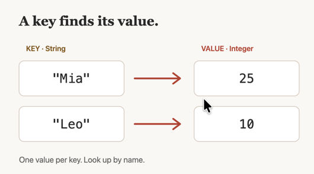

# Vehicle Inventory Application
This little terminal application keeps track of a collection of vehicles and allows the user to do some basic operations like list all vehicles and search.

here's a bullet list:
  * option 1
  * option 2

Here's my search using a hash map:
```java
    public static void searchForMakeModel(String searchMakeModel, HashMap<String, Vehicle> vehicleMap) {
        Vehicle v = vehicleMap.get(searchMakeModel);
        v.display();
    }
```

## Original menu:
1. List all vehicles
2. Search by make/model  
3. Search by price range 
4. Search by color 
5. Add a vehicle 
6. Quit

## New menu:
1. List all vehicles
2. Reports
   1. Search by make/model  
   2. Search by price range 
   3. Search by color 
3. Add a vehicle 
4. Quit


Here's a random diagram of a `HashMap`:  
